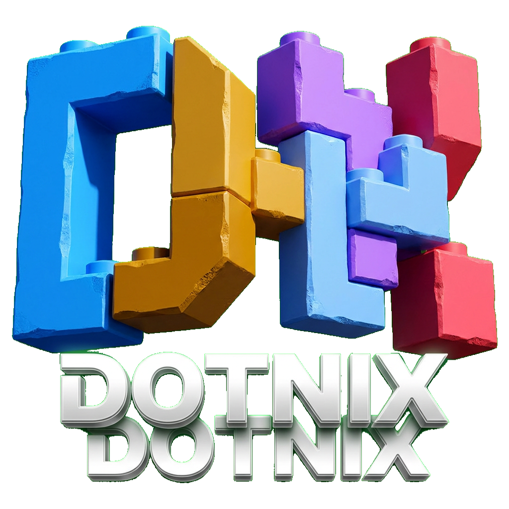

<div align="center">
  

  [](https://github.com/NixOS/nixpkgs/tree/nixos-26.05)
  [](https://github.com/nix-community/home-manager/tree/release-26.05)
  [](LICENSE)

  **Personal Home Manager dotfiles for Linux + macOS — reproducible, declarative, zero drift.**
</div>

---

## 📖 Overview

Keeping a home environment consistent across machines usually means scattered configs, manual
installs, and "works on my machine" drift. This flake declares the entire home environment as
code — packages, dotfiles, and tool configs all version-controlled in one place — so one
command applies a fully reproducible setup on any supported machine.

## 🚀 Quick start

**New machine, no Nix installed** — one line: no clone, no `git`, nothing to edit. It
installs Nix (via the [Determinate installer](https://install.determinate.systems/)) if
missing, then applies this flake with the account set to your `$USER`:

```sh
curl -fsSL https://raw.githubusercontent.com/NoSugarCoffee/dotnix/main/scripts/bootstrap-macos.sh | bash
```

If Nix wasn't installed yet, open a new terminal and re-run. If no proxy is listening on the
port in `lib/proxy.nix`, it installs and opens only Clash Verge, then stops: import a
subscription and re-run; uncached downloads in the full switch use the proxy. Skip that gate
(no proxy or a TUN / system VPN) with `DOTNIX_DIRECT=1`; a different proxy port requires
updating `lib/proxy.nix` first. Clash-managed shells already export `http(s)_proxy` toward
`127.0.0.1:7890`, so drop those for both `curl` and the piped `bash` or the fetch still
hits the dead proxy:

```sh
env -u http_proxy -u https_proxy -u HTTP_PROXY -u HTTPS_PROXY -u all_proxy -u ALL_PROXY \
  curl -fsSL https://raw.githubusercontent.com/NoSugarCoffee/dotnix/main/scripts/bootstrap-macos.sh \
  | env -u http_proxy -u https_proxy -u HTTP_PROXY -u HTTPS_PROXY -u all_proxy -u ALL_PROXY DOTNIX_DIRECT=1 bash
```

Re-run any time to update. On a machine that already wrote `impure-env` and whose proxy is
down, bootstrap tells you to start the Clash Verge you already have instead of trying a
download that cannot succeed — or re-run with `DOTNIX_DIRECT=1` to drop the daemon proxy
line and switch with uncached fetches going direct.

**Already have Nix, no home-manager yet** — bootstrap the first switch. This targets the
account configured in `flake.nix` (`liangliangdai` until you fork and rename it), which only
matches `$USER` after `scripts/bootstrap-macos.sh` has run on this checkout:

```sh
# Linux
nix run .#home-manager -- switch --flake ".#$(nix eval --raw .#username)-x86_64-linux"

# macOS (Apple Silicon)
nix run .#home-manager -- switch --flake ".#$(nix eval --raw .#username)-aarch64-darwin"

# macOS (Intel)
nix run .#home-manager -- switch --flake ".#$(nix eval --raw .#username)-x86_64-darwin"
```

**Day to day** — once `just` is on PATH:

```sh
just switch
```

## 📦 Managed packages

| | 🍎 🐧 Both | 🍎 macOS only | 🐧 Linux only |
|---|---|---|---|
| **AI** | [codex](https://github.com/openai/codex) · [claude-code](https://github.com/anthropics/claude-code) (not Intel macOS) · [claude-desktop](https://claude.ai/download) · [pi](https://pi.dev/) · [apm](https://microsoft.github.io/apm/) · [ccstatusline](https://github.com/sirmalloc/ccstatusline) · [paperclip](https://paperclip.ing) · [orca](https://github.com/stablyai/orca) · [agent-access](https://github.com/bitwarden/agent-access) · [bitwarden-cli](https://bitwarden.com/help/cli/) · [grok-bot](https://x.ai/bot) | [ChatGPT](https://learn.chatgpt.com/docs/app) | — |
| **Terminal** | [kitty](https://sw.kovidgoyal.net/kitty/) · [zellij](https://zellij.dev/) · [zoxide](https://github.com/ajeetdsouza/zoxide) · [yazi](https://github.com/sxyazi/yazi) · [ripgrep](https://github.com/BurntSushi/ripgrep) · [nix-zsh-completions](https://github.com/nix-community/nix-zsh-completions) | — | — |
| **Editors** | [intellij-idea-ultimate](https://www.jetbrains.com/idea/) · [cursor](https://cursor.com/) | [jetbrains-air](https://air.dev/) · [pulsar](https://pulsar-edit.dev/) | — |
| **Dev** | [git](https://git-scm.com/) · [git-open](https://github.com/paulirish/git-open) · [gh](https://cli.github.com/) · [glab](https://gitlab.com/gitlab-org/cli) · [docker](https://www.docker.com/) (client) · [docker-compose](https://docs.docker.com/compose/) · [asdf](https://asdf-vm.com/) (go, nodejs, java, maven) · [pnpm](https://pnpm.io/) · [python3](https://www.python.org/) (ipython, pip) · [ruby](https://www.ruby-lang.org/) · [just](https://just.systems/) · [android-sdk](https://developer.android.com/tools) · [lark-cli](https://www.npmjs.com/package/@larksuite/cli) | [colima](https://github.com/abiosoft/colima) · [cocoapods](https://cocoapods.org/) | — |
| **Browsers** | — | [google-chrome](https://www.google.com/chrome/) · [ego-lite](https://github.com/citrolabs/ego-lite) | — |
| **Screen** | [obs-studio](https://obsproject.com/) | [macshot](https://github.com/sw33tLie/macshot) | — |
| **Network** | [clash-verge-rev](https://www.clashverge.dev/) | [tailscale](https://tailscale.com/) (app + CLI) | [tailscale](https://tailscale.com/) (CLI + daemon) |
| **Utilities** | — | [albert](https://albertlauncher.github.io/) · [maccy](https://maccy.app/) · [scroll-reverser](https://pilotmoon.com/scrollreverser/) · [cida](https://github.com/Xuanwo/cida) · [digup](https://github.com/ARahim3/DigUp) | [copyq](https://hluk.github.io/CopyQ/) |

## 🔧 Commands

| Command | Description |
|---------|-------------|
| `just switch` | Apply the configuration |
| `just build` | Build without switching |
| `just generations` | Show Home Manager generations |
| `just update` | Update flake inputs |
| `just show` | Show flake outputs |
| `just test` | Run the Python tests with CI's bash, rsync and GNU coreutils |
| `just nix-proxy` | Route the Nix daemon's uncached downloads through Clash (macOS, sudo) |

## 🔄 Automated flake updates

`update-flake-lock` ([.github/workflows/flake-update.yml](.github/workflows/flake-update.yml))
opens a daily PR bumping flake inputs and enables auto-merge (squash) on it, so it only lands
once CI goes green — it never merges directly. Three repository settings are required for that
to actually work end to end:

- **`UPDATE_PAT` secret.** Must be a fine-grained PAT (or other long-lived token) with
  `contents: write` and `pull-requests: write` on this repo — **not** a GitHub App installation
  token, which expires after an hour and would silently break the next scheduled run once it
  does. The workflow falls back to the default `GITHUB_TOKEN` if the secret is unset, but
  `GITHUB_TOKEN`-authored `pull_request` runs are held for manual approval rather than running
  automatically, so set `UPDATE_PAT` for the PR to get CI (and therefore auto-merge) on its own.
- **`Allow auto-merge`** must be enabled in the repository's General settings. Without it,
  `gh pr merge --auto` fails outright instead of queuing the PR for merge once checks pass.
- **Branch protection on `main`** must require the `lint`, `build-linux`, and `build-macos`
  status checks (the `ci.yml` jobs) before merging. Auto-merge only completes the squash once
  those checks report success.

## 🍴 Fork

The username is a single source of truth in `flake.nix`:

```nix
let
  username = "liangliangdai";
```

Everything else (`homeConfigurations` attribute names, `home.username`,
`homeDirectory`, CI) reads from there directly or via `nix eval --raw .#username`.
Fork the repo and change just that string — that's the whole rebranding step.

A new machine doesn't even need that edit: `scripts/bootstrap-macos.sh` rewrites the
`username`/`homeDirectory` lines to the machine's `$USER`/`$HOME` in a throwaway copy of the
source (via `scripts/inject-account.sh`). Keep each on **one** line — the rewrite is
line-level and fails loudly if either doesn't match.

## 📝 Notes

- **zsh is managed.** Move an existing `~/.zshrc` aside before the first switch; machine-local config goes in an untracked `~/.zshrc-local`.
- **git config is not.** Per-checkout identity needs `includeIf` paths, so `~/.gitconfig` is hand-written.
- **Codex and Claude Code settings stay writable.** A switch seeds them if missing and resets only the keys declared in `apps/codex/managed.toml` and `apps/claude-code/settings.nix`.
- **Several Claude Code accounts, one config.** `claude-profile NAME [args…]` runs `claude` signed in to a separate account under `~/.claude-profiles/NAME`, with everything else in `~/.claude` symlinked in and MCP servers / per-project state synced through `~/.claude.json` around each run. With two profiles open at once, the last to exit wins for MCP servers.
- **asdf pins Go / Node / Java / Maven** to explicit versions in `apps/asdf/default.nix`. Python comes from nixpkgs instead, since asdf compiles it from source.
- **Docker on macOS is colima.** A launchd agent starts the VM at login; resize it with `colima stop && colima start --cpu 4 --memory 8`. On Linux the daemon is a system service, out of scope here.
- **Tailscale on macOS** is the standalone app. Open it after switching, then approve its VPN configuration and system extension when prompted. On Linux, the package provides `tailscale` and `tailscaled`; the host must run the daemon as a system service before `tailscale up` can connect.
- **Ad-hoc-signed macOS apps are re-signed locally.** Nix builds like kitty and Albert carry a signature that changes with every rebuild, which silently invalidates Accessibility / Screen Recording grants. A switch re-signs their copies in `~/Applications/Home Manager Apps` with a self-signed `dotnix local code signing` certificate it creates in the login keychain, so grants survive updates. The first switch that migrates an app to this identity still changes its code identity once -- macOS treats that as a new app, so expect to re-grant Accessibility / Screen Recording for kitty and Albert one more time right after that switch; it then sticks across every rebuild after. Without a login keychain at `~/Library/Keychains/login.keychain-db` (headless activation, CI) it warns and leaves the copy ad-hoc signed instead of failing.
- **Packages nixpkgs lacks** (the macOS repacks of OBS, Clash Verge, Pulsar, Albert, …) come from [NoSugarCoffee/nur-packages](https://github.com/NoSugarCoffee/nur-packages), which follows each upstream release 4× a day and serves builds from `nosugarcoffee.cachix.org` on Apple Silicon and Linux (Intel Macs build them locally against the 26.05 pin); AI agents come from [numtide/llm-agents.nix](https://github.com/numtide/llm-agents.nix), which has no Intel Mac builds. Neither needs anything here beyond `nix flake update`.
- **China mirrors.** `scripts/bootstrap-macos.sh` adds SJTU/TUNA/USTC substituters; check with `nix config show | grep substitut`.
- **On macOS, the Nix daemon downloads through Clash.** Anything no cache has (unfree packages like the Android SDK, GitHub release assets) is fetched by the daemon, which ignores the shell's proxy. Bootstrap sets `impure-env` in `/etc/nix/nix.custom.conf` to the proxy in `lib/proxy.nix`; on a machine set up before that, run `just nix-proxy` once. Those downloads then fail while Clash Verge is down. `DOTNIX_DIRECT=1` (bootstrap and `just nix-proxy`) skips the write and, if a proxy-routing `impure-env` line is already there, removes it and restarts the daemon so uncached downloads go direct.

## 📄 License

MIT — see [LICENSE](LICENSE).
